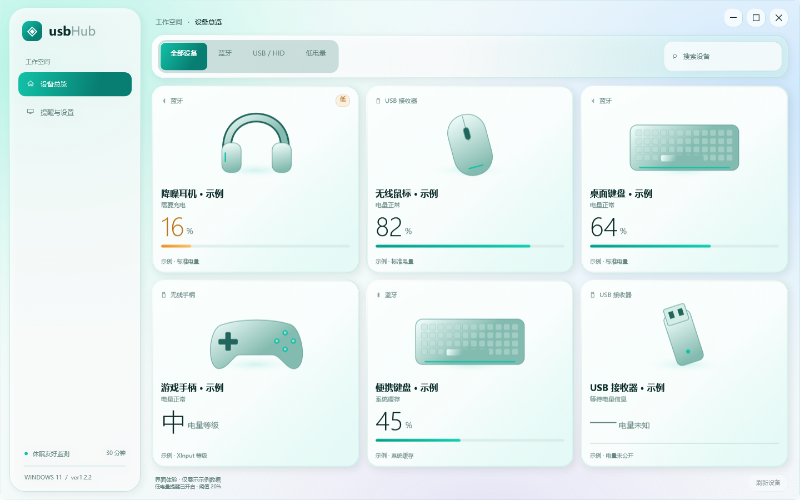

# usbHub

**在 Windows 11 上集中查看无线外设电量。**

usbHub 是一个使用 C#、.NET 10 和 WPF 开发的桌面工具，将鼠标、键盘、耳机、手柄等设备的电量集中显示在设备总览和系统托盘面板中。界面采用浅色液态玻璃设计，通过 Windows 已有的蓝牙、USB 和 HID 接口读取设备信息，无需安装额外内核驱动。


[](LICENSE)

## 界面预览



右键点击托盘图标，即可展开紧凑的电量面板：


> 截图由程序的隔离预览模式生成，使用带有“示例”标记的演示数据，不代表所有图示设备均已完成实机适配。

## 主要功能

- **集中查看电量**：区分蓝牙、USB / HID 和无线手柄，展示百分比或设备提供的电量等级。
- **查找与筛选**：按名称或制造商搜索，按蓝牙、USB / HID、低电量筛选；设备较多时支持分页。
- **系统托盘面板**：保留一个托盘图标，面板展示设备类型、电量、充电与缓存状态，可打开主窗口、刷新或退出。
- **低电量提醒**：阈值可设为 5%–50%，默认 20%；充电、离线、未知、过期或缓存读数不会触发提醒。
- **统一查询间隔**：所有设备主动查询每 30 分钟最多一轮，手动刷新、插拔、系统恢复、重启和诊断入口共用持久化计划。
- **玻璃界面**：支持 Windows Desktop Acrylic、半透明卡片和设备插画；关闭透明效果或使用高对比度时回退为不透明背景。
- **本地运行**：不上传设备数据，默认不设置开机自启、不安装服务，也不修改外设固件、配对或按键配置。

## 设备支持

是否能读取电量，取决于设备和接收器公开的协议。**识别到设备或接收器，不代表一定能获得实时电量。**

| 读取方式 / 设备 | 可读取内容 | 当前范围与限制 |
| --- | --- | --- |
| Windows 电量属性 | 系统驱动维护的蓝牙电量 | 始终标记为缓存，不用于低电量提醒 |
| 蓝牙 BLE GATT | Battery Service `180F` / Battery Level `2A19` | 需要设备已配对、已连接，且公开该服务；实机支持依设备而定 |
| 通用 HID | 描述符公开的电量百分比或容量字段 | 仅查询声明了电量字段的设备，不读取键盘输入流 |
| Logitech HID++ | 电量、充电状态、设备名称 | 当前适配 `046D:C547` 接收器，已在 G502 X LIGHTSPEED 上读取电量，不代表全系列支持 |
| ASUS ROG PELTA | 电量百分比、充电状态 | 当前适配 `0B05:1B84` 的厂商控制集合 |
| XInput 手柄 | 空、低、中、满电量等级 | 保留等级，不换算成虚构百分比；可能与其他来源重复显示 |
| NuPhy Air75 V3 | 型号识别与兼容状态 | 已识别 `19F5:2620`；**2.4 GHz 电量尚未支持**，蓝牙电量仍需实机验证 |

适配按 VID/PID、HID usage 和报告结构匹配，不绑定电脑上的某个 USB 端口。更详细的协议来源见 [PROTOCOLS.md](docs/PROTOCOLS.md)，NuPhy 的研究与限制见 [NUPHY.md](docs/NUPHY.md)。

## 快速开始

### 运行环境

- Windows 11 x64。
- Desktop Acrylic 需要 Windows 11 22H2（构建 22621）及以上；系统透明效果关闭时使用不透明背景。
- 自包含包已内置 .NET 运行库；依赖框架的包需要预先安装 **Microsoft .NET 10 Desktop Runtime x64**。
- 普通用户权限即可运行，无需以管理员身份启动。

### 使用程序包

本仓库保存项目源码。可按下文自行构建 ZIP 程序包；若已获得构建好的包，按以下步骤运行：

1. 将 ZIP 解压到任意可访问的文件夹。
2. 双击 `UsbHub.exe`。
3. 在“设备总览”中查看设备，在“提醒与设置”中调整阈值、通知和关闭窗口后的行为，点击“保存设置”应用。

默认关闭主窗口后继续在托盘运行。**右键点击托盘图标**展开电量面板，单击或双击图标恢复主窗口；面板中的“退出”可完全关闭程序。点击面板外部或按 `Esc` 收起，悬停不会展开面板。

### 查询与提醒规则

- 定时刷新、手动刷新、设备插拔、系统恢复和 `--scan` 都遵守同一个 30 分钟主动查询间隔。
- 冷却期间显示明确标记的缓存结果；查询失败也会占用本轮间隔，重启程序不会立即重试。
- 打开托盘面板只展示已有数据，不发起设备通信。
- 同一设备在本次运行中最多每 4 小时提醒一次；充电或电量恢复后可以重新启用提醒。
- “发送测试通知”的实际显示受 Windows 通知和勿扰设置影响。

## 从源码构建

在 Windows 上安装 **.NET 10 SDK** 和 Git，然后在 PowerShell 中执行：

```powershell
git clone https://github.com/Railgun19998/usbHub.git
cd usbHub

# 构建自包含程序包，无需用户另装 .NET 运行库
.\scripts\Build.ps1 -SelfContained
```

当前版本为 **ver1.2.2**，输出为：

```text
artifacts/usbHub-ver1.2.2-win-x64.zip
```

如果希望使用已安装的运行库并减小包体积：

```powershell
.\scripts\Build.ps1
```

输出文件名带有 `-framework-dependent.zip` 后缀。两种 ZIP 都只包含 `UsbHub.exe` 和 `使用说明.txt`；源码、测试、调试符号、扫描结果与用户设置不进入程序包。单文件 EXE 可单独复制，首次运行会将原生运行库解压到系统临时目录。

构建脚本优先使用项目本地 `.tools/dotnet/dotnet.exe`，不存在时使用 `PATH` 中的 `dotnet`。首次构建需要网络以还原依赖；本地 SDK、缓存和构建产物不纳入 Git。

### 验证

```powershell
# 核心回归检查、WPF 编译，以及隔离数据下的离屏界面检查
.\scripts\Test.ps1
```

默认检查不会注册测试托盘、操作鼠标键盘、发送通知或主动访问外设，也不会停止正在运行的用户实例。界面预览与检查报告写入 `artifacts/preview/`，隔离设置写入 `artifacts/test-data/`。

需要实际显示托盘面板、验证桌面交互时，再显式运行：

```powershell
.\scripts\Test.ps1 -InteractiveTray
```

此模式会短暂显示并激活测试面板，需要可交互的 Windows 桌面。自动化检查不代替真实设备的蓝牙连接、插拔、充电变化和低电量通知验收。

## 网页设计预览

直接用浏览器打开项目根目录的 [usbhub.html](usbhub.html) 或 [usbhub-popup.html](usbhub-popup.html)，可查看主界面与托盘面板的独立网页设计预览。两者共用 `ui/` 资源，使用演示数据，不连接硬件，也不进入桌面程序的发布 ZIP。

## 数据与隐私

默认配置与扫描缓存保存在：

```text
%LOCALAPPDATA%/usbHub/
├── settings.json     # 用户设置
└── scan-state.json   # 最近扫描结果和主动查询计划
```

设置不写入程序目录。设备扫描在独立工作进程中执行，按设备提供方和整轮扫描分别设置超时，避免驱动调用阻塞主界面。

程序只对已核对的设备协议发送电量查询，不探测未知命令，不更改灯光、音效、按键、配对或固件。构建阶段的依赖下载与程序运行时的设备读取是两个独立流程。

## 常见问题

**能发现设备，为什么电量仍是“未知”？**

USB 接收器、PnP 记录或蓝牙配对记录只能说明设备可被发现。设备可能尚未连接，也可能没有公开标准电量字段，或需要尚未实现的厂商协议；程序不会将未知值当作 0%。

**点击刷新后，电量为什么没有立刻变化？**

主动查询每 30 分钟最多一轮。冷却期间会继续展示缓存；关闭并重启程序也不会绕过该限制。

**系统显示了电量，为什么没有低电量提醒？**

Windows 缓存属性没有可确认的实时更新时间，因此只用于展示。提醒还要求设备已确认连接、读数足够新鲜且没有在充电。

**NuPhy Air75 V3 能使用吗？**

当前支持型号识别，但未实现通过 2.4 GHz 接收器读取实时电量。蓝牙模式是否公开可用的 Battery Service，仍需对应设备连接验证。

## 项目结构

```text
src/UsbHub.Core/     设备模型、解码、合并、提醒、设置与扫描计划
src/UsbHub.App/      WPF 界面、ViewModel、系统 API 与设备读取
tests/UsbHub.Tests/  无需硬件的核心回归检查
scripts/            构建、打包、界面检查与图标生成
docs/               开发规范、协议来源、适配记录与界面截图
ui/                 网页设计预览共用资源
artifacts/          本地程序包和检查输出，不纳入 Git
```

版本以 [Directory.Build.props](Directory.Build.props) 为准，并与应用 manifest 同步。功能更新递增第二段并将第三段重置为 `1`，修复与优化递增第三段，同一发布只递增一次。完整规则见 [开发说明](docs/DEVELOPMENT.md)。

## 设计与协议参考

玻璃材质参考 [AndroidLiquidGlass / Backdrop](https://github.com/Kyant0/AndroidLiquidGlass) 的背景采样、透镜边缘与高光思路；桌面端使用 WPF 和 Windows Desktop Acrylic 实现。详见 [液态玻璃设计说明](docs/LIQUID_GLASS.md)。

设备读取接口与报文字段的参考来源集中记录于 [协议资料](docs/PROTOCOLS.md)。项目独立实现读取逻辑，不随程序打包第三方完整驱动或配置工具。

## 许可证

本项目采用 [MIT License](LICENSE)。第三方资料与参考项目的许可证以各自仓库为准。
